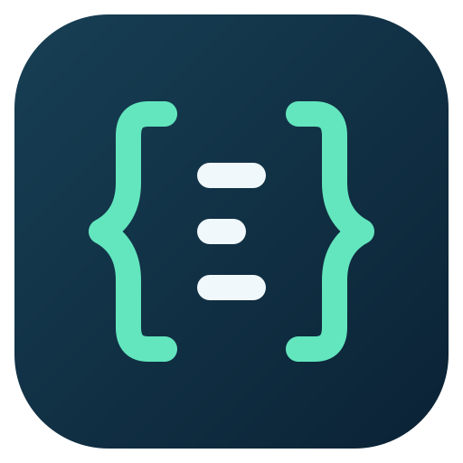
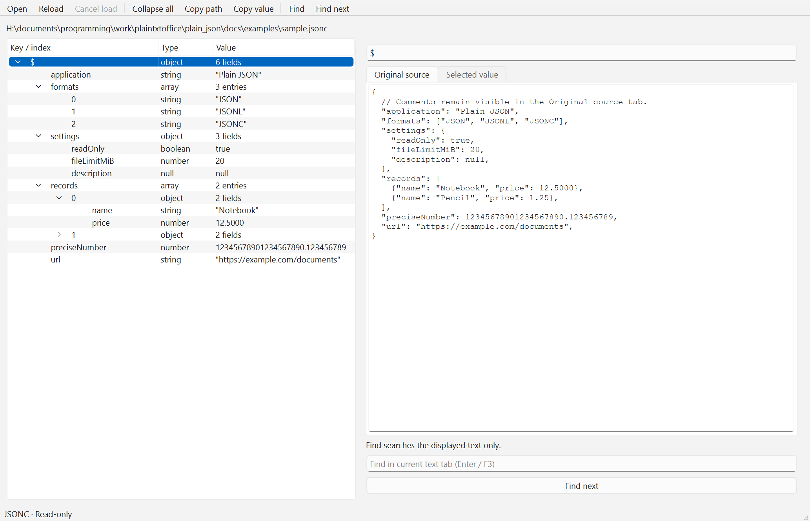

<!-- last_updated: 2026-11-14 -->
<!-- Authoring guidance: dev-docs/specs/README_SPEC.instructions.md -->
<!-- rumdl-disable MD033 MD041 -->

  

<h1 align="center">Plain JSON</h1>

  A read-only viewer for exploring JSON, JSONL, and JSONC files on Android and
  Windows.

  
  
  

  <a href="#download">Download</a> ·
  <a href="docs/USER_MANUAL.md">User manual</a> ·
  <a href="https://plaintxtoffice.com/apps/">Website</a>

<!-- rumdl-enable MD033 MD041 -->

---

## About

**Development status:** The Android app is available on
[Google Play](https://play.google.com/store/apps/details?id=com.plaintxtoffice.plainjson).
The Windows version is still in development and has no public download yet.

Plain JSON helps you inspect structured documents and line-oriented logs
without the risk of changing them. Browse nested values as a tree alongside
the original text, and get a readable error when a file cannot be parsed.

Your files stay on your device. The viewer reads them locally and never edits
them, and there is no account to create and no advertising.

## Features

- Open `.json` files for free, up to 20 MiB.
- Expand nested objects and arrays in a tree that shows each key, type, and
  value, loading large lists 200 entries at a time.
- Read the original source next to the tree, including JSONC comments.
- See the path of the selected entry, and copy the path or its JSON value.
- Keep numbers exactly as written, including large integers and long decimals.
- Search the displayed text.
- Reload a file after changing it elsewhere; the previous document stays open
  if the new load fails.
- Open `.jsonc` files with comments and trailing commas, free on Android.
- Preview the first 50 records of `.jsonl` and `.ndjson` files for free.

Paid, on Android (released): a one-time $9.99 Google Play purchase with no
subscription adds full access.

- Open whole `.jsonl` and `.ndjson` files of any size.
- Open `.json` and `.jsonc` files over 20 MiB.
- Jump to a record by number, filter records by text, and list the fields
  across all records of a JSON Lines file.

Paid, on Windows (in development, not yet on sale): full `.jsonl`, `.ndjson`,
and `.jsonc` files and files over 20 MiB. Until then Windows shows a preview
of those formats.

## App Screenshot

<!-- rumdl-disable MD033 -->

  

  Windows, in development and not yet available to download.

<!-- rumdl-enable MD033 -->

## Download

| Platform | Download | Notes |
| --- | --- | --- |
| Android | [Google Play](https://play.google.com/store/apps/details?id=com.plaintxtoffice.plainjson) | Free, with an optional in-app purchase. |

## User Manual

See the [User Manual](docs/USER_MANUAL.md) for installation, usage, supported
formats, licensing, limits, and troubleshooting.

## License

Plain JSON is proprietary software. Copyright © 2026 Plain Text Office LLC.
All rights reserved. See [LICENSE](LICENSE) for terms and permission requests.
